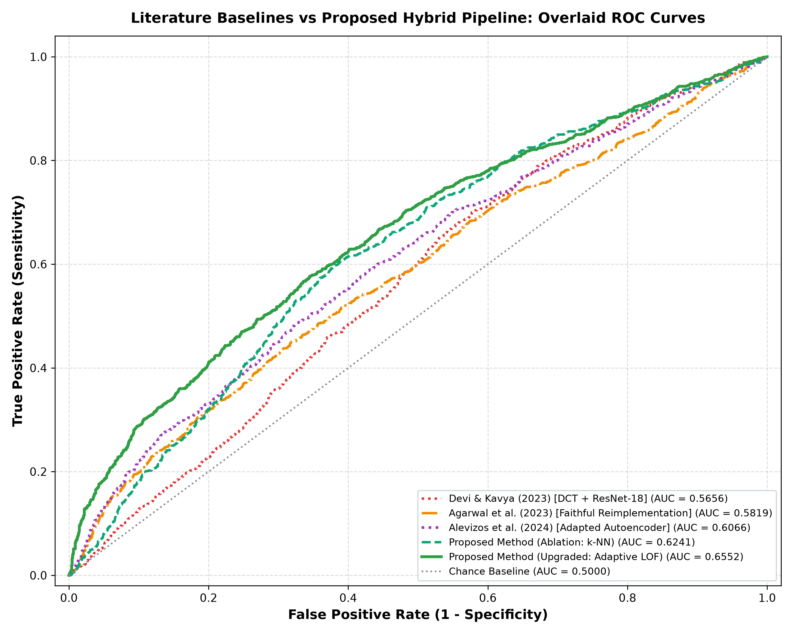
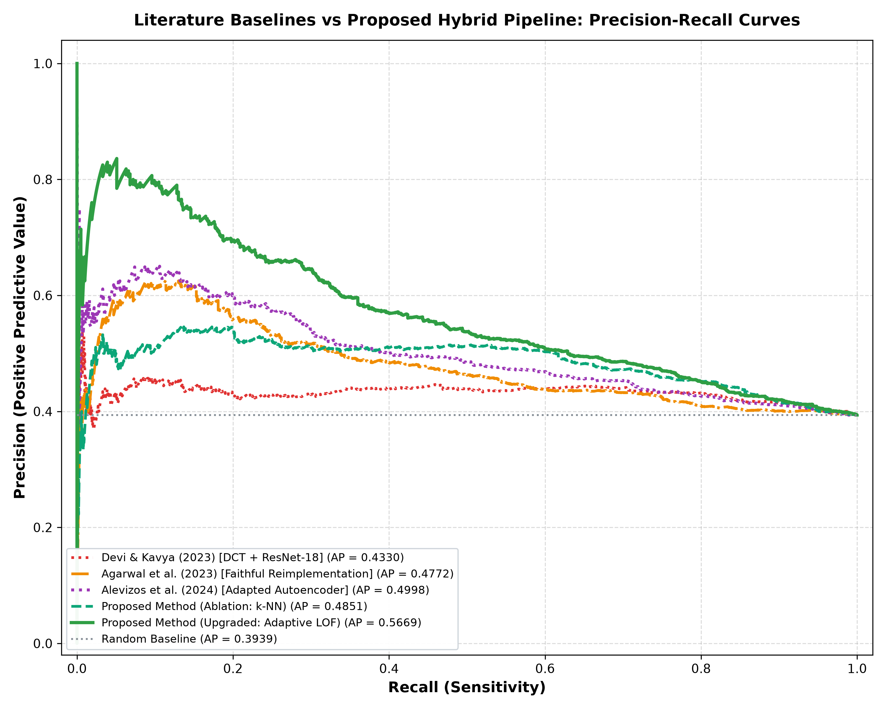

# Locked Baseline Benchmark Results

## Status: LOCKED
**Random Seed:** 42  
**Protocol:** One-class unsupervised anomaly detection (Reference Clean $N=1,539$, Synthetic $N=1,000$).

---

### Master Empirical Baseline Metrics

| Method | Overall ROC-AUC | Overall PR-AUC | Blur AUC | Dropout AUC | Thickening AUC | Thinning AUC | Sensitivity (@5% FPR) | F1-Score |
|:---|:---:|:---:|:---:|:---:|:---:|:---:|:---:|:---:|
| **Devi & Kavya (2023) [DCT + ResNet-18]** | 0.5656 | 0.4330 | 0.5963 | 0.5162 | 0.5693 | 0.5822 | 9.3% | 0.1583 |
| **Agarwal et al. (2023) [Faithful Reimplementation]** | 0.5819 | 0.4772 | 0.6265 | 0.5250 | 0.5950 | 0.5858 | 13.7% | 0.2257 |
| **Alevizos et al. (2024) [Adapted Autoencoder]** | 0.6066 | 0.4998 | 0.5934 | 0.6007 | 0.6305 | 0.6005 | 14.3% | 0.2344 |
| **Proposed Method (Ablation: k-NN)** | 0.6241 | 0.4851 | 0.6788 | 0.5462 | 0.6285 | 0.6468 | 11.9% | 0.2000 |
| **Proposed Method (Upgraded: Adaptive LOF) [Target Baseline]** | **0.6552** | **0.5669** | **0.7321** | **0.5743** | **0.6728** | **0.6508** | **24.8%** | **0.3743** |

---

### Benchmark Plots

---

### Files in this Directory:
- `metrics.csv`: Machine-readable master metrics and classification counts.
- `predictions.csv`: Individual sample anomaly scores across all 2,539 forms for every baseline.
- `roc_curves.png`: 5-Method Literature Benchmark ROC curves.
- `pr_curves.png`: 5-Method Literature Benchmark Precision-Recall curves.
- `configuration.json`: Complete specification of parameters, seeds, and dimensions.
- `README.md`: This reference specification.
